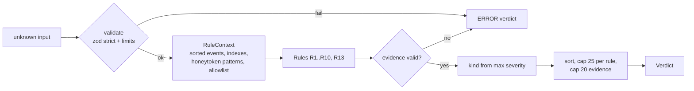

# Design Document: rules-engine

## Overview

`judge(input: unknown): Verdict` in `base/core` is the only entry point that decides. It:

1. validates the input with strict zod schemas (any failure gives ERROR),
2. sorts events by `seq` and builds a read-only `RuleContext`,
3. runs the rules in a fixed order (R1–R10, then R13),
4. checks every finding's evidence (a rule that produces bad evidence is a bug, so the result is ERROR),
5. computes the verdict from **all** findings, then sorts and caps them for output.

It never throws. Any exception inside becomes an ERROR verdict. Callers only allow an install when `allowsInstall(verdict)` is true, which means SAFE.



### Decisions that differ from `docs/plan.md`

| Plan | Here | Why |
|---|---|---|
| R10 (process left running) is Medium | **High** | Medium doesn't change the verdict, so a detached process that waits out the observation window would get SAFE. That fails open (see blue-team note BT-7). |
| Event cap: "recorded and treated as suspicious" | New rule **R13**, High | It makes the cap explicit and testable. |
| ScanInput carries static findings | Left out | Nothing uses them until R11 and R12. They'll be added with that spec. |
| The cache key is name, version, and integrity | Also includes the **ruleset version** | A verdict from old rules is never served as current. Stored events can be re-judged without re-running the package. |

## Architecture

All files are in `base/core/src/`. Each is pure, with no I/O, clock, or randomness. That is enforced by `tsconfig` (no Node types) and Biome (restricted globals).

| File | Responsibility |
|---|---|
| `limits.ts` | Every size limit and threshold, as named constants. |
| `text.ts` | `quote()` (cap and escape untrusted text for display) and `redactToken()`. |
| `paths.ts` | `normalisePath()`, `isInside()`, `basename()`, `segments()`. POSIX only. |
| `hosts.ts` | `normaliseHost()`, `compileAllowlist()`, `matchesAllowlist()`, `isLoopback()`, `canonicalIp()`. |
| `encoding.ts` | Pure base64 (standard and URL-safe), hex, and lenient percent-decoding over byte strings. |
| `honeytokens.ts` | `compileHoneytokens()` and `findHoneytokens()`. |
| `schema.ts` | zod schemas for `Event` and `ScanInput`, plus `validateScanInput()`. |
| `context.ts` | `buildContext()`: sorted events, attribution, indexes. |
| `programs.ts` | `programName()` (with busybox and toybox), and the program and argument sets used by R4, R5, R7, and R8. |
| `rules/*.ts` | One file per rule, for example `rules/r01-honeytoken-exfil.ts`. Each exports a `Rule`. |
| `rules/index.ts` | `RULES`, the ordered list. |
| `verdict.ts` | `SEVERITY_RANK`, `kindFromFindings()`, `judge()`, `errorVerdict()`, `allowsInstall()`, `RULESET_VERSION`. |
| `cache-key.ts` | `verdictCacheKey()`. |
| `errors.ts` | `SietchError`, plus `InvalidPackageIdentityError`. |
| `index.ts` | Public exports. |

## Data models

### Event (normalised)

The fields common to all events are `seq` (an integer, 0 ≤ seq ≤ 2³¹−1, unique), `t` (milliseconds since the scan started, a finite number ≥ 0; recorded but not used by the rules), and `phase` (`"install" | "load" | "linger"`).

| `type` | Extra fields |
|---|---|
| `exec` | `pid`, `ppid`, `path` (the executable passed to execve), `argv: string[]` |
| `file_read` | `pid`, `ppid`, `path` |
| `file_write` | `pid`, `ppid`, `op: "create" \| "write" \| "truncate" \| "delete" \| "rename" \| "chmod" \| "mkdir" \| "symlink" \| "hardlink"`, `path`, `target` (required for `rename` (the destination), `symlink` and `hardlink` (what the link points to). Not allowed for other ops.) |
| `connect` | `pid`, `ppid`, `protocol: "tcp" \| "udp"`, `address` (an IP literal), `port` (0–65535) |
| `exit` | `pid`, `ppid`, `code: int \| null`, `signal: string \| null` |
| `dns` | `name`, `qtype` (no pid: the sink sees queries, not processes) |
| `http` | `method` (`^[A-Z]{1,16}$`), `scheme: "http" \| "https"`, `host`, `path` (including the query), `headers: [name, value][]`, `body` (a byte string: one character per byte, codes 0–255), `bodyTruncated: boolean` (no pid) |

`pid` and `ppid` are integers from 0 to 2³¹−1. Objects are strict (`z.strictObject`), so unknown keys are rejected.

### ScanInput

```ts
interface ScanInput {
  package: { name: string; version: string; integrity: string };
  environment: {
    home: string;               // the fake home directory, absolute
    projectDir: string;         // where npm install runs
    nodeModulesDir: string;     // must be inside projectDir
    tmpDirs: string[];          // for example ["/tmp", "/var/tmp"]
    packageManagerPid: number;
    sinkAddresses: string[];    // IPs of the capture sink
    extraCredentialPaths: string[]; // honeytoken files planted outside the defaults
  };
  allowlist: string[];          // "host.example" or "*.example.com"
  honeytokens: { id: string; kind: HoneytokenKind; value: string }[];
  events: Event[];
  eventsTruncated: boolean;
}
type HoneytokenKind = "npm" | "github" | "aws-access-key" | "aws-secret-key" | "gcp" | "ssh-key" | "env" | "generic";
```

### Limits (`limits.ts`)

| Constant | Value |
|---|---|
| `MAX_EVENTS` | 50,000 |
| `MAX_PATH` | 4,096 characters |
| `MAX_ARGV` / `MAX_ARG` | 256 entries / 8,192 characters |
| `MAX_HEADERS` / `MAX_HEADER_NAME` / `MAX_HEADER_VALUE` | 100 / 256 / 8,192 |
| `MAX_HTTP_PATH` / `MAX_HOST` / `MAX_DNS_NAME` | 8,192 / 255 / 1,024 |
| `MAX_BODY` / `MAX_TOTAL_BODY` | 1 MiB / 16 MiB (characters) |
| `MAX_HONEYTOKENS` | 64. Values: printable ASCII `[\x21-\x7e]`, 16–512 characters, unique. IDs `^[a-z0-9_-]{1,64}$`, unique |
| `MAX_ALLOWLIST` | 500 patterns |
| `MAX_DIRS` | 8 temp directories, 8 sink addresses, 64 extra credential paths |
| `MAX_NAME` / `MAX_VERSION` | 214 / 256 |
| `MAX_EVIDENCE_PER_FINDING` | 20 |
| `MAX_FINDINGS_PER_RULE` | 25 |
| `MAX_QUOTE` | 200 characters |
| `WIPER_THRESHOLD` | 20 distinct paths |

Every string must be well-formed UTF-16 (`String.prototype.isWellFormed`), and must not contain NUL. Paths and directories must also start with `/` and contain no control characters (U+0000–U+001F, U+007F–U+009F).

### Finding and Verdict

```ts
type Severity = "Low" | "Medium" | "High" | "Critical";
const SEVERITY_RANK = { Low: 1, Medium: 2, High: 3, Critical: 4 } as const;
type RuleId = "R1" | "R2" | "R3" | "R4" | "R5" | "R6" | "R7" | "R8" | "R9" | "R10" | "R13";

interface Finding {
  ruleId: RuleId;
  severity: Severity;
  title: string;        // fixed per rule
  explanation: string;  // untrusted values only through quote(); honeytokens only through redactToken()
  evidence: number[];   // seqs, ascending, unique, 1..20 entries, all present in the input
}

type Verdict =
  | { kind: "SAFE" | "SUSPICIOUS" | "MALICIOUS"; rulesetVersion: string; findings: Finding[]; omittedFindings: number }
  | { kind: "ERROR"; rulesetVersion: string; reason: string; findings: []; omittedFindings: 0 };
```

`RULESET_VERSION = "1.0.0"`. Any change to rule behaviour bumps it.

## Components and interfaces

### Validation (`schema.ts`)

`validateScanInput(input: unknown): { ok: true; value: ScanInput } | { ok: false; reason: string }`

- Uses `z.strictObject` throughout, and refinements for duplicate `seq`, duplicate honeytoken IDs and values, `nodeModulesDir` inside `projectDir`, the `target` presence rule, and the total body size.
- The reason is built only from the zod issue's `path` and `code`, for example `events.12.path: too_big`. It is capped at 300 characters and passed through `quote()`. zod messages and unrecognised key names are never copied, because they can contain attacker-chosen text.

### Paths (`paths.ts`)

- `normalisePath(p)`: splits on `/`, drops empty and `.` segments, and resolves `..` without going above `/`. Returns `"/" + segments.join("/")`. Input is already validated as absolute.
- `isInside(child, root)`: true when the segments of `root` are a prefix of the segments of `child`. **Never** compares strings with `startsWith`, so `/a/bc` is not inside `/a/b`.
- All event paths, link targets, and environment directories are normalised once, in `buildContext`.

### Hosts (`hosts.ts`)

- `normaliseHost(raw)`: lowercase, strip a `:port` (and `[ ]` around IPv6), strip one trailing dot. The result must match `^[a-z0-9_.-]{1,253}$` or be a canonical IP. Otherwise it returns `null`, and null is never allowlisted.
- `compileAllowlist(patterns)`: each pattern is either an exact host or `*.` followed by a host. Anything else is a validation error. Matching is exact equality, or `host.endsWith("." + suffix)` with a non-empty label before it.
- `canonicalIp(addr)`: dotted IPv4. `::ffff:a.b.c.d` maps to IPv4. IPv6 is lowercased as given (not compressed further). Loopback is `127.0.0.0/8` and `::1`. Anything that doesn't parse is treated as **external** (fail closed).

### Encoding (`encoding.ts`)

These work on byte strings (each character code 0–255). There is no `Buffer`, `TextEncoder`, or `atob`, because the package is pure and has no DOM or Node types.

- `base64Encode(bytes, alphabet: "std" | "url")`, following RFC 4648.
- `hexEncode(bytes)`, in lowercase.
- `percentDecode(text)`: lenient. `%XX` with two hex digits becomes that byte. Anything else is kept as is. Single pass.

### Honeytoken matcher (`honeytokens.ts`)

`compileHoneytokens(tokens)` builds a list of patterns, each `{ tokenId, encoding, text, haystackForm }`:

| Encoding | Pattern | Searched in |
|---|---|---|
| `raw` | the value | the text as is |
| `hex` | lowercase hex of the value | the text, lowercased |
| `base64` | for each alphabet (std, url) and each offset k ∈ {0,1,2}: `stable(encode(fill_k + value), k, len)` | the text with whitespace removed |
| `double-base64` | for each of the 6 single-base64 patterns S, each outer alphabet, and each k: `stable(encode(fill_k + S), k, len(S))` | the text with whitespace removed |

**Alignment-stable slice.** Base64 maps each 3-byte group to 4 characters. When the secret starts at byte offset k (mod 3) inside a larger payload, the 4-character groups made only of secret bytes don't depend on the surrounding bytes. Those characters are `encode(fill_k + value)` from index `k > 0 ? 4 : 0` up to `floor((k + len) / 3) * 4`. This catches a token inside base64 of an arbitrary JSON blob, which is what Shai-Hulud exfiltrated, whatever its position. With the minimum token length of 16, every slice is at least 16 characters long.

`findHoneytokens(text)`:

1. Build candidates: `[text, percentDecode(text), percentDecode(percentDecode(text))]`, dropping duplicates. Each candidate records how many decodes it took.
2. For each candidate, build the three search forms once (as is, lowercased, whitespace removed), and test each pattern with `indexOf`.
3. Return each distinct `(tokenId, encoding, percentDecoded)` once, ordered by token, then encoding.

The cost is O(text length × number of patterns × pattern length), and the number of patterns is fixed per scan (44 per token at most). No regular expressions are used.

### Programs (`programs.ts`)

`programName(exec)` is the lowercase basename of `path`. If that is `busybox` or `toybox` and `argv[1]` exists, it's `basename(argv[1])` instead. For R7, a `node` exec whose first non-option argument's basename is `npm-cli.js`, `pnpm.cjs`, `pnpm.js`, `yarn.js`, or `yarn.cjs` counts as `npm`, `pnpm`, or `yarn`.

Argument sets (from npm 11's own `cmd-list.js`):

- **Registry writes:** `pu publ publi publis publish pub unp unpu unpub unpubl unpubli unpublis unpublish dep depr depre deprec depreca deprecat deprecate logi login add- add-u add-us add-use add-user addu addus adduse adduser token`. Any argument that doesn't start with `-` and equals one of these (case-insensitive) matches. Over-matching, for example `npm install token`, is accepted: fail closed.

### RuleContext (`context.ts`)

```ts
interface RuleContext {
  input: ScanInput;                 // validated
  events: readonly NormEvent[];     // sorted by seq, with normalised path and target
  isPackageEvent(e: NormEvent): boolean; // !(e.pid === packageManagerPid && e.phase === "install"); dns and http are always true
  env: { home; projectDir; nodeModulesDir; tmpDirs; sinkAddresses: Set<string> }; // normalised
  allowedWriteRoots: string[];      // nodeModulesDir, tmpDirs, home/.npm, home/.cache, home/.node-gyp, /dev/pts
  allowedWriteFiles: Set<string>;   // /dev/null, /dev/stdout, /dev/stderr, /dev/tty
  credentialRoots: string[];        // home + each entry in Requirement 6.3, plus extraCredentialPaths
  allowlist: CompiledAllowlist;
  honeytokens: CompiledHoneytokens;
}
```

### Rules

Each rule is `{ id, title, evaluate(ctx): FindingDraft[] }`, where `FindingDraft = { severity, explanation, evidence: number[] }`.

| Rule | Logic |
|---|---|
| **R1** | For every `http` event, scan the host, path, each header name and value, and the body. For every `dns` event, scan the name, then the name with dots removed. DNS is case-insensitive, so for `dns` the raw match also compares lowercase to lowercase. Each `(event, token)` gives one Critical finding: "Sent honeytoken <kind> (<redacted>) <encoding> to <quoted host>". |
| **R2** | Package `file_read` where `isCredentialPath(path)`, and package `file_write` with op `symlink` or `hardlink` where `isCredentialPath(target)`. `isCredentialPath` is: inside any credential root; or segments `[proc, …, environ\|mem]`; or a basename matching `^\.env(\..+)?$` outside `nodeModulesDir`. High. |
| **R3** | `dns` names, `http` hosts, and package `connect` addresses that aren't sink addresses, loopback, or allowlisted. One finding per distinct destination. Its evidence is that destination's events, capped at 20. High. |
| **R4** | Track the paths that package `file_write` events with op `create`, `write`, `truncate`, or `chmod` produced, plus `rename` and `hardlink` targets. A later package `exec` of a tracked path outside `nodeModulesDir` gives High, citing the write and the exec. A package `exec` whose program is `bun`, `bunx`, or `deno` gives High. |
| **R5** | Package `exec` whose program is in the network tool set, or is `openssl` with `s_client` in its arguments. High. |
| **R6** | For each package `file_write`, check `path`, and also `target` for `rename`. If a path is outside the allowed write roots and files, it's High, or Critical if it contains the segment pair `.github`, `workflows`. One finding per distinct path. |
| **R7** | `http` to an npm registry host (`registry.npmjs.org`, `registry.npmjs.com`, `registry.yarnpkg.com`, `npm.pkg.github.com`) with `PUT` or `DELETE`, or a path starting `/-/npm/v1/tokens`, `/-/whoami`, or `/-/user/`. Also any `exec` (including the package manager's) whose program is npm, pnpm, yarn, or bun with a registry-write argument. Critical. |
| **R8** | `http` to `api.github.com`, `uploads.github.com`, or `github.com` with a write method, unless the path ends in `/git-upload-pack`: Critical. `exec` of git with argument `push`: Critical. `http` GET to `api.github.com` with path `/user` or `/user/…`: High. `exec` of `gh`: High. |
| **R9** | Distinct paths from package `file_write` with op `delete` or `truncate`, or `rename` sources, outside the allowed write roots. If there are 20 or more: one Critical finding, with the first 20 events as evidence. |
| **R10** | Walk the package events in seq order, keeping an open "incarnation" per pid (its first seq, and whether it saw `linger`). An `exit` closes the incarnation, so later events with that pid start a new one. Open incarnations at the end, and any incarnation with a `linger` event, give High findings citing the incarnation's first event. |
| **R13** | `eventsTruncated` gives High, citing the largest seq. |

### Verdict (`verdict.ts`)

```text
judge(input):
  try:
    v = validateScanInput(input);           if !v.ok -> ERROR(v.reason)
    if no exec events                       -> ERROR("trace has no exec events; recording probably failed")
    ctx = buildContext(v.value)
    drafts = for rule in RULES: rule.evaluate(ctx) tagged with rule.id
    for each draft: evidence = sorted unique; if empty or any seq not in ctx -> ERROR("rule <id> produced invalid evidence")
    kind = kindFromFindings(all drafts)     # computed BEFORE capping
    findings = sort(by RULE_ORDER, first evidence, explanation), cap 25 per rule, cap evidence to 20
    return { kind, rulesetVersion, findings, omittedFindings }
  catch error:
    return ERROR("internal error: " + (error instanceof Error ? error.name : "unknown"))
```

`kindFromFindings`: max rank 4 is MALICIOUS, max rank 3 is SUSPICIOUS, anything else is SAFE.

### Cache key (`cache-key.ts`)

`verdictCacheKey({ name, version, integrity }, rulesetVersion)` gives `verdict:v1:` followed by the four components, each passed through `encodeURIComponent` and joined with `:`. `encodeURIComponent` always encodes `:`, so no component can contain the separator. It throws `InvalidPackageIdentityError` (code `INVALID_PACKAGE_IDENTITY`) when:
- name is empty, longer than 214 characters, or not well-formed;
- version is empty or longer than 256 characters;
- integrity doesn't match `^sha512-[A-Za-z0-9+/]{86}==$`;
- rulesetVersion is empty.

## Contract for the trace producer

The future `trace-normaliser` and `sandbox-runner` specs must guarantee these. The engine relies on them, and the blue-team notes list what happens if they're broken.

1. `pid` is the process (thread group) ID, not a thread ID.
2. Every process exit is emitted exactly once, as an `exit` event. Processes killed when the sandbox is torn down get **no** exit event.
3. Phase changes happen when npm exits (install becomes load) and when the load harness exits (load becomes linger).
4. Paths are absolute and resolved against the cwd or dirfd. Symlink targets are resolved against the link's directory. If a path can't be resolved, the scan fails (ERROR), and the event is never dropped.
5. Install runs offline against pre-fetched tarballs, so npm itself makes no network requests.
6. Multi-line secrets, such as SSH keys, are registered as a single-line honeytoken: their base64 body.
7. The sandbox runner's own processes (the container's init, timers, and the harness wrapper) are left out of the events. Otherwise R10 fires on every scan.
8. `bodyTruncated` is true whenever the capture sink cut a body short. R13 then flags it.
9. Symlink and hard link creation is always emitted as a `file_write` event, so later paths can be resolved through it.
10. The capture sink records DNS (53), HTTP (80), and HTTPS (443). Traffic to it on any other port is flagged by R3.

## Changes after review (2026-11-18)

The security review (`docs/reviews/2026-11-18-rules-engine-security-review.md`) and the blue-team pass (`docs/reviews/2026-11-18-rules-engine-blue-team.md`) changed the design as follows:

| Change | Why |
|---|---|
| New module `views.ts`: each path is checked under every name it can be reached by (earlier symlinks and hard links, `..` applied after a link, `/proc/<p>/root`, `/proc/<p>/cwd`). Writes are allowed only if **every** view is allowed. An unresolvable chain is never allowed. | SR-1, SR-2: writes and reads through a symlinked directory or `/proc/self/root` got SAFE. |
| `programNames()` returns the names of every view, so a symlink can't hide `curl`. A `Map` is used for script lookups. | SR-2, SR-6 |
| R3 flags connections to the sink on ports it doesn't record. | SR-3 |
| `MAX_HONEYTOKENS` is 16 (was 64), and all scanned traffic text is capped at 24 MiB. | SR-4 |
| Environment checks: `nodeModulesDir` strictly inside `projectDir`; `home` and `projectDir` not `/`; temp directories may not contain either. | SR-5 |
| R13 also fires when a request body was cut off. | BT-20: a truncated body to an allowlisted host got SAFE. |
| Base64 matching ignores up to 2 characters at each end of a token, because those depend on neighbouring bytes. | Found while testing. Tokens are random, so this isn't a realistic false-positive source. |

## Error handling

| Situation | Result |
|---|---|
| Input fails the schema or limits | ERROR with field path and issue code |
| No `exec` events, or truncated with no events | ERROR |
| A rule returns empty or unknown evidence | ERROR (an engine bug must never become SAFE) |
| Any exception | ERROR naming the error class only |
| Invalid cache key input | Throws `InvalidPackageIdentityError` (the caller is our own code, and a key must never be guessed) |

## Correctness properties

Each property is a fast-check test in a `*.prop.test.ts` file. Seeds come from `test/fast-check.setup.ts`.

- **Property 1: Determinism and order independence.** For any valid ScanInput, `judge(x)` deep-equals `judge(structuredClone(x))` and `judge(x with events shuffled)`. **Validates: Requirements 18.1, 18.2, 3.4**
- **Property 2: Never throws.** For any value (`fc.anything()`, and valid inputs with one field mutated), `judge` returns a Verdict and doesn't throw. **Validates: Requirements 2.1, 1.1, 1.8**
- **Property 3: Evidence integrity.** For any valid input, every finding has 1 to 20 evidence seqs, ascending, unique, and all present in the input. **Validates: Requirements 16.1, 16.2**
- **Property 4: Adding a finding never makes the verdict safer.** For any findings F and any finding f, `rank(kindFromFindings(F ∪ {f})) ≥ rank(kindFromFindings(F))`, where SAFE < SUSPICIOUS < MALICIOUS. **Validates: Requirements 17.1, 17.2, 17.3**
- **Property 5: The verdict matches the severities.** For any valid input, the kind is MALICIOUS if and only if some finding is Critical, and SAFE if and only if none is High or Critical. Checked before capping, using `omittedFindings`. **Validates: Requirements 17.1–17.3, 16.3**
- **Property 6: Only SAFE allows an install.** For any Verdict, `allowsInstall(v)` is equivalent to `v.kind === "SAFE"`. **Validates: Requirements 2.5**
- **Property 7: Honeytokens are found in every supported encoding.** For any token, any printable filler before and after, any encoding (raw, hex upper or lower, base64 std or url at any offset inside an encoded larger payload, double base64, each optionally percent-encoded once or twice, base64 optionally line-wrapped at 76), `findHoneytokens` reports the token. **Validates: Requirements 4.1–4.4**
- **Property 8: Honeytokens are never shown in full.** For any valid input that triggers R1, no finding's explanation contains any honeytoken value. **Validates: Requirements 16.4**
- **Property 9: The cache key is injective.** For any two valid identities and ruleset versions, the keys are equal if and only if all four components are equal. **Validates: Requirements 19.1, 19.3**
- **Property 10: Path containment works on segments.** For any root and any path, `isInside(p, root)` holds if and only if `segments(root)` is a prefix of `segments(p)`. In particular, `root + "x"` (a sibling with the same prefix) is never inside. **Validates: Requirements 6.3, 10.1**
- **Property 11: Allowlist matching is exact.** For any pattern and host, the result is true only if the host equals the pattern, or the pattern is `*.s` and the host is `l.s` for some non-empty `l`. Hosts like `s.evil`, `evils`, and `s` (for `*.s`) never match. **Validates: Requirements 7.4, 7.5**
- **Property 12: Normalisation is idempotent.** For any absolute path, `normalisePath(normalisePath(p)) === normalisePath(p)`, and the result starts with `/` with no `.` or `..` segments. **Validates: Requirements 1.3**
- **Property 13: Exfiltration always makes it MALICIOUS.** For any valid input, adding one `http` event whose body contains any registered honeytoken in any supported encoding produces MALICIOUS. **Validates: Requirements 5.1, 17.1**
- **Property 14: Control characters are rejected.** For any valid input with a NUL or control character inserted into any event path, `judge` returns ERROR. **Validates: Requirements 1.3, 1.8**

## Testing strategy

- **Unit tests** (`*.test.ts`) per module and per rule. Each rule has a positive case, a negative case, and the bypass attempts from the blue-team notes below.
- **Property tests** (`*.prop.test.ts`), as listed above. The generators live in `src/__fixtures__/arbitraries.ts`: valid ScanInputs whose events are drawn from a benign vocabulary by default, plus per-rule injectors.
- **Fixtures** (`src/__fixtures__/`) are hand-written TypeScript builders, not recorded traces. Honeytoken values are built at run time (`"npm_" + "x".repeat(36)`).
  - `worm.ts`: Shai-Hulud-like. Preinstall reads `~/.npmrc` and `~/.config/gh/hosts.yml`, forks a detached process that sends `base64(JSON)` containing the npm token to `exfil.sietch-demo.invalid` during `linger`, and writes `.github/workflows/x.yml`. Expected: MALICIOUS, with R1, R2, R3, R6, and R10.
  - `esbuild-like.ts`: postinstall resolves `registry.npmjs.org` (allowlisted), GETs a tarball, writes `node_modules/esbuild/bin/esbuild`, chmods it, runs `esbuild --version`, and every process exits during install or load. Expected: SAFE with zero findings.
  - `shai-hulud-2.ts`: writes `~/.bun/bin/bun` and runs it (R4), runs `curl` (R5), deletes 25 files in home (R9). Expected: MALICIOUS.
- **Coverage table:** every rule has at least one fixture or unit case that fires it, and one that is a near miss and doesn't fire.

## Blue-team notes

| ID | Evasion | Handled by | Residual risk |
|---|---|---|---|
| BT-1 | Symlink `/tmp/a` to `~/.npmrc`, then read `/tmp/a` | R2 on symlink and hardlink targets | A link created by a process the trace attributes to npm. That would need code running inside npm, which installs don't do. |
| BT-2 | Run malware in the package manager's process to escape R2–R6 | Only install-phase events of that exact pid are exempt. R1, R7, and R8 apply to it anyway | Depends on contract item 1 (correct pids). |
| BT-3 | Base64 token at an odd offset inside a larger JSON blob | Alignment-stable slices (3 offsets) | None for base64 and double base64. |
| BT-4 | Line-wrapped base64 (`base64` CLI wraps at 76) | Whitespace removed before base64 search | Wrapped inner base64 inside double base64 isn't caught. R2 and R3 still apply. |
| BT-5 | base32, XOR, reversed, gzip, or chunks split across requests | Not decoded | Accepted, and documented in the README. R2 (credential read) and R3 (unknown host) still give SUSPICIOUS. |
| BT-6 | Flood events to push the evidence past the cap | R13 makes truncation High | None. |
| BT-7 | Detach and sleep past the observation window | R10 is High: no exit, or activity during linger | A process that exits cleanly before the window ends and acts some other way later (cron is impossible in the sandbox). |
| BT-8 | `busybox wget` to hide the tool name | Applet resolved from `argv[1]` | Custom static binaries: R4 covers them when written outside `node_modules`. |
| BT-9 | Write `x.yml` and then rename it into `.github/workflows` | R6 checks rename targets | None. |
| BT-10 | Fake an exit by reusing a pid | Incarnations end at `exit`, and later events start a new one | Depends on contract item 2. |
| BT-11 | DNS 0x20 case randomisation breaking base64 in DNS names | Raw and hex matching are case-folded for DNS | Base64 in DNS names under case changes is not caught. R3 still flags the unknown name. |
| BT-12 | `::ffff:`-mapped or odd IP forms to dodge the sink check | Canonicalised. Anything unparsable counts as external | None (fail closed). |
| BT-13 | Look-alike hosts (`registry.npmjs.org.evil.invalid`, Unicode) | Exact or proper-suffix matching on normalised ASCII | None (fail closed). |
| BT-14 | Exfiltrate to an allowlisted host (a gist, a registry) | R1 ignores the allowlist | Data that isn't a registered honeytoken (for example source code). |
| BT-15 | Overwrite `/dev/tty` or `/proc/*` to tamper | Only exact harmless devices are allowed. Other `/dev` and `/proc` writes are R6 | None. |
