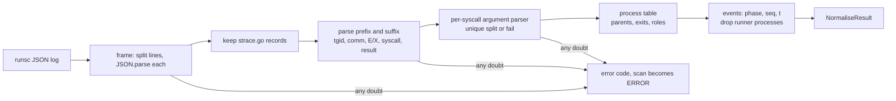

# Design Document: trace-normaliser

## Overview

`normaliseTrace(log: string, layout: RunnerLayout): NormaliseResult` in `base/core/src/trace/`. It turns gVisor's JSON debug log into rules-engine events. The scan worker then merges these with the capture sink's `dns` and `http` events and calls `judge()`.



Everything is pure TypeScript: string scanning, with no regular expressions that could backtrack on attacker text. Each stage is a small function with its own tests.

## Why JSON logs and strace, not runtime monitoring

See `docs/spikes/trace-sample.md`. The text log can be forged with a newline in a file name, and the JSON log can't. gVisor's runtime monitoring is more structured but needs a `SOCK_SEQPACKET` client, which Node.js can't open. It's recorded as the upgrade path.

## Inputs

```ts
interface RunnerLayout {
  readonly initPid: number;         // the container's init process, normally 1
  readonly tracedSyscalls: readonly string[]; // exactly the --strace-syscalls list used
}
```

The runner's entrypoint must start the install process (npm) as init's **first** child, the load harness as its **second**, and nothing else before them. The `sandbox-runner` spec owns the entrypoint.

## Stage 1: framing (`trace/frame.ts`)

- Refuse a log over `MAX_LOG_BYTES` (64 MiB) or `MAX_RECORDS` (500,000 lines): `TRACE_TOO_LARGE`.
- Split on `\n`. Ignore one trailing empty line. Any other empty line, or a line that doesn't parse as a JSON object with a string `msg` and a string `time`, is `UNFRAMED_RECORD`. The reason gives the line number only.
- Keep records whose `msg` starts with `strace.go:` followed by digits and `] `. Others are gVisor's own messages.
- Parse `time` (RFC 3339 with nanoseconds and an offset) with a small pure parser into milliseconds since the epoch. `t` is relative to the first strace record. A malformed time is `MALFORMED_RECORD` (gVisor writes it, so it should never happen).

## Stage 2: record parsing (`trace/record.ts`)

```
strace.go:609] [  13:  13] touch X openat(AT_FDCWD /tmp, 0xfdff… nl\nname, O_RDWR|O_CREAT|0x20000, 0o666) = 3 (0x3) (6µs)
              └ tgid: tid ┘ └comm┘ │ └syscall┘└────────── args ──────────────────────────────┘ └──── result ──────┘
```

1. `[` spaces digits `:` spaces digits `] ` gives tgid and tid (integers up to 2³¹−1).
2. The **comm** is 1 to 15 bytes and may contain anything. Look for ` E ` or ` X ` followed by `[a-z0-9_]+(` at each offset from 1 to 16 after `] `. **Exactly one** offset must match, or it's `AMBIGUOUS_RECORD`.
3. The syscall name must be in `layout.tracedSyscalls`, or it's `UNEXPECTED_SYSCALL`.
4. Exit records: strip the result from the **end** with a hand-written scanner for `) = -?\d+ (\(0x[0-9a-f]+\)|errno=\d+ \([^()]*\)) \([0-9.]+(ns|µs|ms|s)\)`. What's left between the opening `(` and that `)` is the argument text. Enter records: only `exit_group` is used. Its argument is a single hex code.

## Stage 3: per-syscall argument parsers (`trace/syscalls.ts`)

Attacker strings (paths, link targets, cwd names) appear unquoted. Fixed tokens (`, 0x<hex> `, `AT_FDCWD `, flag names, `0o<octal>`) are what we split on, and **every parser counts how many ways the split can be made. Anything but exactly one is `AMBIGUOUS_RECORD`.** Fields after the last attacker string are taken from the end, so they can't be faked by text inside the string.

| Syscall | Printed form (from the fixture) | Event |
|---|---|---|
| `execve` | `0x<a> PATH, 0x<a> [ARGV…], 0x<a> [ENVP…]` | `exec`. ARGV is a list of quoted, escaped strings, parsed by a quoted-list scanner. Candidate splits are each `, 0x<hex> [` after which ARGV, then `, 0x<hex> [` ENVP, then the end, parse cleanly. **Envp is discarded** (it holds honeytokens). More than 4 candidates is `AMBIGUOUS_RECORD`. |
| `execveat` | like `execve`, with a dirfd first | as above. A path relative to a non-`AT_FDCWD` dirfd is `UNRESOLVED_PATH`. |
| `openat` | `DIRFD CWD, 0x<a> PATH, FLAGS, 0o<mode>` | `file_read` if the access mode is `O_RDONLY` (no `O_WRONLY` or `O_RDWR`). Otherwise `file_write` with op `truncate` (`O_TRUNC`), `create` (`O_CREAT`), or `write`. |
| `mkdirat` | `DIRFD CWD, 0x<a> PATH, 0x<mode>` | `file_write` `mkdir` |
| `unlinkat` | `DIRFD CWD, 0x<a> PATH, 0x<flags>` | `file_write` `delete` |
| `renameat`, `renameat2` | `DIRFD CWD, 0x<a> OLD, 0x<newdirfd>, 0x<a> NEW[, 0x<flags>]` | `file_write` `rename`, target NEW |
| `linkat` | `DIRFD CWD, 0x<a> OLD, 0x<newdirfd>, 0x<a> NEW, 0x<flags>` | `file_write` `hardlink`, path NEW, target OLD |
| `symlinkat` | `0x<a> TARGET, DIRFD CWD, 0x<a> LINKPATH` | `file_write` `symlink`, path LINKPATH, target TARGET resolved against LINKPATH's directory |
| `fchmodat` | `DIRFD CWD, 0x<a> PATH, 0o<mode>` | `file_write` `chmod` |
| `connect` | `0x<fd> socket:[n], 0x<a> {Family: AF_INET[6], Addr: IP, Port: N}, 0x<len>` | `connect`, success or failure. `AF_UNIX` and other families are ignored. `protocol` is `"tcp"` (see Open questions). |
| `sendmsg`, `sendto` | `… {name=0x<a>, namelen=N, …}` | When `namelen > 0`: a `connect` with `address: null` (destination not recorded). |
| `clone`, `clone3` | `FLAGS, …) = CHILD` | A process if FLAGS has no `CLONE_THREAD` (symbolic) and no `0x10000` bit (hex). Records `parent[CHILD] = tgid`. An unknown format counts as a process. |
| `exit_group` (E) | `0x<code>` | `exit` with that code |
| `wait4`, `waitid` | `…) = PID` | `exit` for PID, if it hasn't exited yet (covers processes killed by a signal) |
| `kill`, `tgkill` | | Parsed and ignored (kept in the trace list for later rules) |

**Directory file descriptors.** `DIRFD` is `AT_FDCWD`, followed by the working directory gVisor prints. A `0x<hex>` newdirfd equal to `0xffffffffffffff9c` (−100) also means `AT_FDCWD`, and resolves against the same CWD. Any other dirfd with a relative path is `UNRESOLVED_PATH`. Joining is lexical. `..` is kept, because `views.ts` resolves it after symlinks.

**Cut-off strings.** The parser rejects a path that gVisor shows as cut off (`TRUNCATED_PATH`). An argv cut off by `--strace-log-size` sets `argvTruncated` on the event. Task 1 confirms exactly how gVisor marks this.

## Stage 4: processes and phases (`trace/processes.ts`)

- `parent: Map<pid, pid>` from non-thread clone results, first seen wins.
- Roles: the first two children of `initPid`, in clone order, are `install` and `load`. Every other child of `initPid`, and `initPid` itself, is a runner process. Each pid's role is inherited from its nearest ancestor that has a role. A pid whose parent chain is unknown (no clone seen) belongs to no role: its events are kept, as package events, and its ppid is set to 0. Keeping them is the fail-closed choice.
- Phase of an event: `install` until the install process's exit, `load` until the load process's exit, then `linger`.
- Exits: the first of `exit_group` (E), or a `wait4`/`waitid` returning the pid. Only one `exit` event per process lifetime. After an exit, a clone that hands out the same pid again starts a new lifetime (PID reuse).
- No install or load child seen: `MISSING_PHASE`.

## Stage 5: output

```ts
type NormaliseResult =
  | { ok: true; events: Event[]; packageManagerPid: number; eventsTruncated: boolean }
  | { ok: false; code: NormaliseErrorCode; reason: string };
```

`seq` starts at 1 in record order. Events after `MAX_EVENTS` are dropped and `eventsTruncated` is set. `reason` is `record <n>: <code>`. It never contains record text.

## Rules engine changes (Requirement 7)

- `connect.address`: `string | null`. R3 treats `null` as an unknown external destination ("sent data to an address that wasn't recorded").
- `exec.argvTruncated?: boolean`. R13 adds a High finding ("an argument list was cut off, so part of the command wasn't checked").
- `RULESET_VERSION` becomes `1.2.0`. The existing tests stay green.

## Error codes

`TRACE_TOO_LARGE`, `UNFRAMED_RECORD`, `MALFORMED_RECORD`, `AMBIGUOUS_RECORD`, `UNEXPECTED_SYSCALL`, `UNRESOLVED_PATH`, `TRUNCATED_PATH`, `MISSING_PHASE`, `INTERNAL`. Each becomes `errorVerdict("trace: <code> at record <n>")` in the worker.

## Correctness properties

- **Property 1: Never throws.** For any string, and any valid fixture with one line mutated, `normaliseTrace` returns a result. **Validates: 6.1, 8.2**
- **Property 2: Framing can't be forged.** For any file name (any characters, including `\n`, quotes, `"msg":`, and fake `strace.go:` lines), the JSON record built the way gVisor builds it yields exactly one event, with that name as the path, and no other event. **Validates: 1.1, 1.2, 2.4**
- **Property 3: The process name can't move the split.** For any 1 to 15-character `comm`, including ` X openat(`, the parse either gives the right syscall or fails with `AMBIGUOUS_RECORD`. It never gives a different syscall. **Validates: 2.1**
- **Property 4: Argument text can't add or change fields.** For any path text, an `openat` record yields the path exactly, or `AMBIGUOUS_RECORD`. The flags and mode always come from gVisor's own suffix. **Validates: 2.4, 3.2**
- **Property 5: Deterministic.** The same input always gives deep-equal output. **Validates: 8.1**
- **Property 6: The output is valid engine input.** For any successful result, `validateScanInput` accepts it with a fixed environment. **Validates: 6.1**
- **Property 7: One exit per lifetime.** For any generated process tree with random exits, kills, and waits, each process lifetime has at most one `exit`, and a reaped child always has one. **Validates: 3.6, 5.2**
- **Property 8: Linear time.** A record with a 4,096-character path made of separators (`, 0x1 , 0x1 …`) is rejected within the timeout. **Validates: 8.3**

## Testing strategy

- **Fixture:** `__fixtures__/gvisor/sample-arm64.strace.jsonl` (real, from the probe). Golden test: the expected event list is checked in by hand for the interesting lines, such as `nl\nname`, `quo"te`, rename, symlink, the killed `sleep`, IPv6, AF_UNIX ignored, and UDP sendmsg with a null address.
- **Hand-built records** for each syscall form and each error code.
- **Property tests** as above.
- **End-to-end:** fixture to `normaliseTrace` to `judge()` in a test, which must not give ERROR. The probe reads `/home/probe/.npmrc`, so R2 should fire when `home` is `/home/probe`.

## Open questions (tracked as tasks)

1. **What gVisor prints for a cut-off path or argv** at `--strace-log-size`. Task 1 records it in the VM with a 4,096-byte path and a 600-argument argv.
2. **The `clone3`, `sendto`, and `waitid` formats** (not seen on ARM64 with `sh` and `node`). Task 1 adds a C-free probe line if one is possible. Otherwise the parsers fail closed with `AMBIGUOUS_RECORD` until we see a sample.
4. **`waitid` reaps are not exits yet** (review TN-3). A process reaped only that way looks lingering, so R10 can over-fire: safe, but noisy. It gets parsed once a real sample exists.
5. **The working directory is read only from a leading `AT_FDCWD` dirfd** (review TN-1). It is never read from other arguments, which can hold attacker text.
3. **The connect protocol.** The log doesn't show the socket type. Every case R3 cares about works with `"tcp"`: UDP and TCP port 53 to the sink are both allowed, and any other port is flagged either way. Tracing `socket` would remove this, later.
